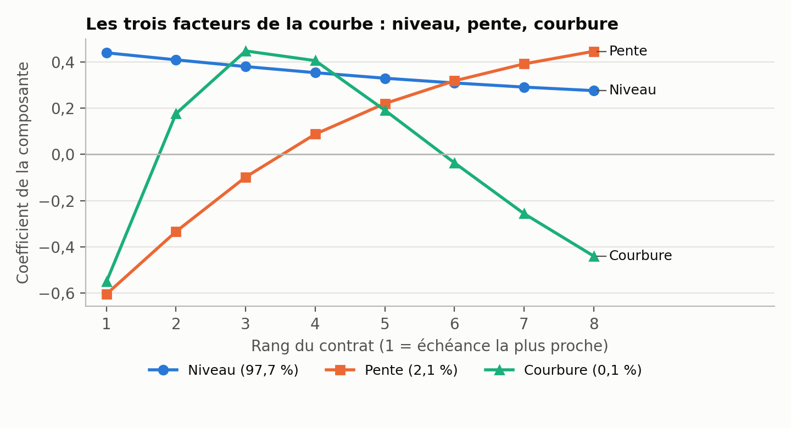
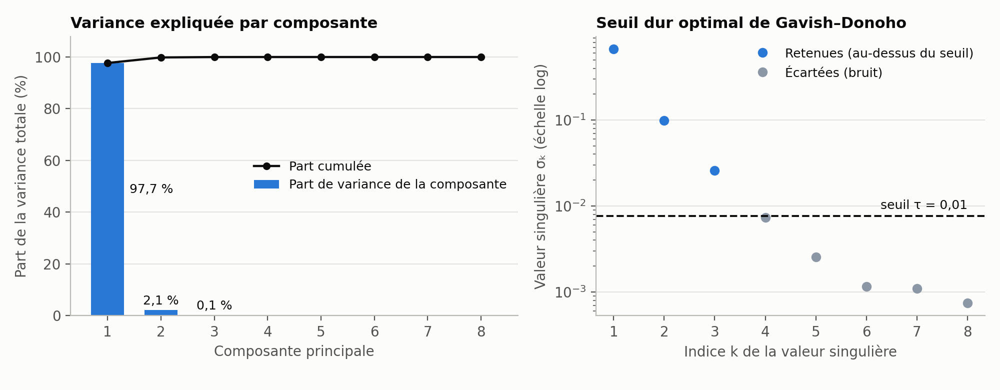

# SVD de la courbe à terme du WTI

Application de la **décomposition en valeurs singulières (SVD)** à la courbe à terme du pétrole WTI : les prix de
8 échéances, qui bougent presque ensemble, se ramènent à **3 facteurs** (niveau, pente, courbure).

Le projet télécharge les contrats sur Yahoo Finance, calcule la SVD des rendements journaliers, trace les figures et
écrit les chiffres de l'analyse dans un fichier JSON. Une note d'analyse de 5 pages (PDF) présente les résultats
et leurs limites : [`note/note_svd_wti.pdf`](note/note_svd_wti.pdf).

## Résultats

Sur 142 jours (23 mars – 13 octobre 2026) et 8 échéances :

| Facteur | Variance expliquée | Lecture |
|---|---|---|
| 1. Niveau | 97,7 % | toute la courbe monte ou descend |
| 2. Pente | 2,1 % | court terme contre long terme |
| 3. Courbure | 0,15 % | milieu de la courbe contre ses extrémités |

Trois facteurs expliquent 99,99 % de la variance et reconstruisent la courbe à 2,4 points de base près (par jour et par échéance).





**Ces résultats décrivent une période courte** (près de sept mois), pendant laquelle la courbe est restée en
backwardation. Voir la section « Limites ».

## Utilisation

```bash
python -m venv .venv
.venv\Scripts\activate           # Windows (Linux/macOS : source .venv/bin/activate)
pip install -r requirements.txt

python -m pytest                 # tests (sur données simulées, hors ligne)
python run_analysis.py           # télécharge les contrats sur Yahoo Finance (quelques minutes), trace tout
python run_analysis.py --reuse   # réutilise le dernier téléchargement (data/contrats_wti.csv)
```

Sorties dans `results/` : `figures/` (5 figures et un visuel) et `resultats.json` (tous les chiffres).
Options : `--start 2021-06-01`, `--maturities 8` (valeur par défaut).

## Méthode

1. **Rendements par rang** d'échéance (rang 1 = contrat le plus proche) : le rendement du rang *k* le jour *t* est celui
   du contrat qui était de rang *k* la veille. Le changement de contrat à l'échéance ne crée donc pas de faux saut.
2. **SVD** de la matrice des rendements centrés `B = U Σ Vᵀ`. Les colonnes de `V` sont les facteurs, `UΣ` les scores,
   `σ²/(T−1)` les variances : c'est l'analyse en composantes principales, sans passer par la matrice de covariance.
3. **Nombre de facteurs** : variance cumulée et seuil optimal de Gavish–Donoho.
4. **Reconstruction** de rang *k* et vérification du théorème d'Eckart–Young.
5. **Identification** niveau / pente / courbure par le nombre de changements de signe des coefficients (0, 1, 2).

## Structure

```
run_analysis.py           point d'entrée
src/svdcurve/pca.py       SVD-ACP, Eckart–Young, seuil de Gavish–Donoho
src/svdcurve/data.py      échéances WTI, téléchargement Yahoo Finance, courbe par rang
src/svdcurve/analysis.py  indicateurs de l'analyse
src/svdcurve/plots.py     figures
tests/                    tests unitaires
results/                  figures et resultats.json
note/                     note d'analyse (PDF ; source LaTeX : note_svd_wti.tex)
```

## Limites

- **Historique court.** Yahoo Finance ne conserve pas les contrats expirés : seuls les contrats encore actifs (14 ici)
  sont téléchargés, d'où 142 jours seulement pour 8 échéances. Un historique plus long demande une autre source de données.
- **Un seul régime.** La courbe est en backwardation tout au long de la période ; les facteurs ne sont pas testés
  sur d'autres régimes de marché.
- **Un jour pèse environ 6 % de la variance totale** (le 23 mars 2026, premier jour de l'échantillon). Une analyse de
  sensibilité sans ce jour n'a pas été faite.
- **Covariance non standardisée** : les échéances proches, plus volatiles, pèsent davantage dans le facteur de niveau.
- **Reproductibilité.** Comme Yahoo ne garde que les contrats actifs, relancer le téléchargement plus tard donne
  d'autres dates et d'autres chiffres que ceux du rapport.
- Les données (prix de clôture Yahoo Finance) ne sont pas recoupées avec les prix de règlement de la CME et ne sont
  pas redistribuées dans ce dépôt.

## Références

- C. Eckart, G. Young, *The approximation of one matrix by another of lower rank*, Psychometrika, 1936.
- M. Gavish, D. Donoho, *The optimal hard threshold for singular values is 4/√3*, IEEE Trans. Inf. Theory, 2014.
- R. Litterman, J. Scheinkman, *Common factors affecting bond returns*, Journal of Fixed Income, 1991.
